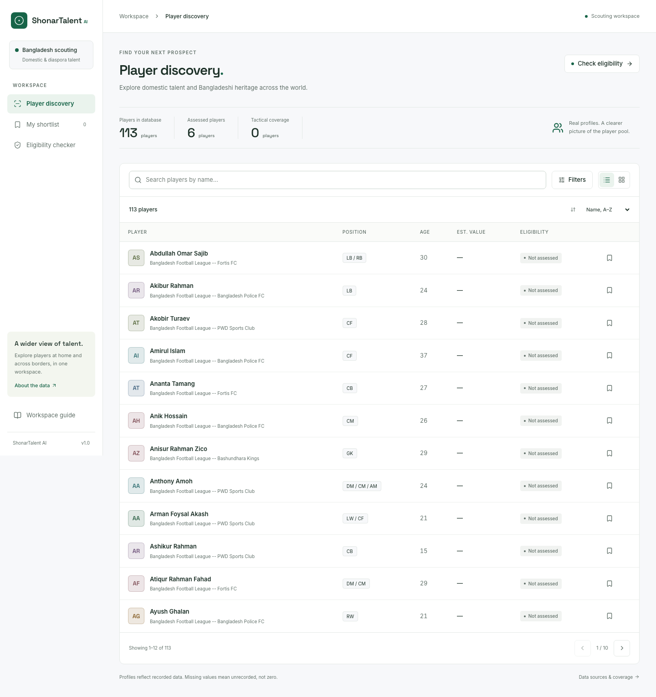

# ShonarTalent AI

A minimal football scouting workspace for Bangladesh’s domestic and diaspora talent. Search player
records, build a local shortlist, inspect tactical data, screen heritage facts and download scout reports.

React 19 / TypeScript / Vite / Tailwind · FastAPI / SQLAlchemy / SQLite · scikit-learn · ReportLab



## Run locally

Requires Python 3.11+ and Node.js 24+. From the project root:

```sh
python3 -m venv .venv
.venv/bin/pip install -e '.[dev]'
cp .env.example .env
.venv/bin/python -m scripts.seed_data
.venv/bin/uvicorn backend.app.main:app --reload --host 127.0.0.1 --port 8000
```

In another terminal:

```sh
cd frontend
npm ci
npm run dev
```

Open [localhost:5173](http://localhost:5173). Vite proxies API calls to port 8000. The default API
URL is `/api/v1`; set `VITE_API_BASE_URL` only when deliberately hosting the API elsewhere.
The interactive API documentation is at [localhost:8000/docs](http://localhost:8000/docs).

To run through one server, build the frontend (`npm run build --prefix frontend`), then start
FastAPI. Open [localhost:8000](http://localhost:8000). Direct profile/shortlist links work after refresh.

## Synthetic demo

The app opens in **Synthetic demo** mode: 160 fictional players, complete metrics, working radar
charts, top-five similarity results, all filters and labelled PDF exports. Choose **Real records**
from the Data source selector to return to sourced profiles. The datasets do not mix in analytics.

```sh
.venv/bin/python -m scripts.seed_synthetic   # repeatable demo-only regeneration
```

No invented values are attached to real players. See [how the demo works](docs/SYNTHETIC-DEMO.md)
for a walkthrough, generation assumptions, metric units, percentile charts and similarity scoring.

## Workflows

- **Discover:** case-insensitive name search, canonical primary/secondary positions, maximum age,
preferred foot, maximum value and recorded eligibility. Sort by name, age or value; use table or
cards and pagination. Search state is preserved in the URL.
- **Inspect:** recorded facts, nullable tactical metrics and percentile radar against the same
league/position cohort median. Missing metrics are never shown as recorded zeros.
- **Shortlist:** bookmark from directory or profile; persists in this browser. Storage failures
show a session-only notice. Shortlists are not synchronized between browsers or teammates.
- **Similarity:** cosine k-NN over standardized per-90 metrics. Missing cells on partial profiles
are mean-imputed; profiles without any metrics are excluded. Empty coverage produces an explanation.
- **Eligibility:** validated ancestry, residency and prior-representation facts, explained result,
and change-of-association review indicator. Editing facts clears the previous assessment.
- **Report:** actual one-page PDF download from a player profile, with recorded facts and data notes.

## Data and limits

The existing local database contains 113 real records from a prior ingestion run (6 maintained
reference profiles and 107 domestic squad records). The database is gitignored; a fresh clone gets
the six maintained profiles and 160 fictional demo profiles through the offline seed command. The seed is idempotent and preserves
previously collected tactical metrics.

```sh
.venv/bin/python -m scripts.seed_data      # offline maintained roster
.venv/bin/python -m scripts.run_scrapers   # optional network refresh
```

Domestic squad listings come from Wikipedia’s Bangladesh Football League club pages. Diaspora
profiles come from `data/seed/diaspora_players.yaml`, with source/verification notes. FBref backfill
uses `soccerdata` and only covers supported competitions. Chrome is needed only for that optional
browser-based source; it is not bundled in the default API container. A failed source is rolled back
without preventing the next source from saving. Source access restrictions are reported, not bypassed.

The current 113-player dataset has **no recorded tactical metrics**. Charts and similarity therefore
usually show coverage explanations. Adding valid source metrics activates the existing pipeline;
no fabricated performance values are included to make the dashboard appear populated.

The eligibility engine is a **simplified legacy screening ruleset**, not a certification of current
FIFA regulations. It does not model all nationality, residency or representation exceptions. Prior
youth and senior representation prompt review. Nationality and official clearance must be confirmed
by the relevant association using [FIFA’s current guidance](https://inside.fifa.com/legal/news/updated-documentation-guidance-player-eligibility-change-association).
The stored `ELIGIBLE & CLEARED` vocabulary is retained for API compatibility and represents a recorded
screening status, not an independent official clearance determination.

## Container

```sh
docker compose up --build
```

Open [localhost:8000](http://localhost:8000). A multi-stage build includes the UI, API, offline seed
and health check. Compose keeps data in `./data`; export reports directly in the browser. Optional
FBref scraping requires a separate Chrome-enabled environment. The image does not force amd64.

This release is an unauthenticated scouting workspace intended for trusted deployment. Public
multi-user access, authentication and shared shortlists require a separate product scope.

## Weekly refresh

The deployment environment owns scheduling. For example, this crontab entry refreshes at 03:00
Monday in the server’s configured timezone:

```cron
0 3 * * 1 cd /absolute/path/BFF-Football && .venv/bin/python -m scripts.run_scrapers >> /absolute/path/scouting-refresh.log 2>&1
```

Ensure the scheduler has source access, Chrome if requesting FBref, and the correct environment.
The process exits non-zero when any source fails and logs a per-source summary. A sample setting
in `.env` does not install a scheduler automatically.

## Validate

```sh
.venv/bin/ruff check .
.venv/bin/pytest
npm run lint --prefix frontend
npm test --prefix frontend
npm run build --prefix frontend
cd frontend
npx playwright install chromium
npm run test:e2e
```

Browser tests start an isolated local server on port 8015 and seed `data/processed/e2e.db`.
They cover discovery, URL filters, paging, shortlist persistence, profile/report export, eligibility,
error recovery and 360px mobile navigation. One external FBref integration test skips when source
access is unavailable. In restricted environments with unrelated pytest plugins, use
`PYTEST_DISABLE_PLUGIN_AUTOLOAD=1 .venv/bin/pytest`.

## Project and specifications

- `backend/`: API, database, screening, similarity and report generation.
- `frontend/`: accessible responsive workspace, local fonts/icons and browser tests.
- `scrapers/`, `scripts/`, `ml/`: ingestion, maintenance and tactical ranking.
- `specs/001-complete-scouting-workspace/`: active Spec Kit specification, plan, tasks and verification.
- `.specify/`: official Spec Kit 1.2.4 templates, commands and project constitution.
- `openspec/`: preserved prior change history and behavior specifications.
- `PRD.md`: original product brief; `PRODUCT.md`: current product context; `DESIGN.md`: design system.

The new delivery follows Spec Kit’s constitution → specification → plan → tasks → implementation
→ convergence workflow. Original numbered specifications remain a historical PRD traceability index;
the completion specification documents current decisions and acceptance evidence.

## Open-source assets

[Lucide icons](https://lucide.dev/license) (ISC / inherited Feather MIT),
[Inter](https://rsms.me/inter/) and [Space Grotesk](https://github.com/floriankarsten/space-grotesk)
(SIL OFL) are self-hosted. Bitstream Vera is embedded in PDF reports through ReportLab. Full license
notices ship in `frontend/public/licenses/`. Player avatars use generated initials. No stock or AI
photo is presented as an actual player. Project code is licensed under [MIT](LICENSE).
